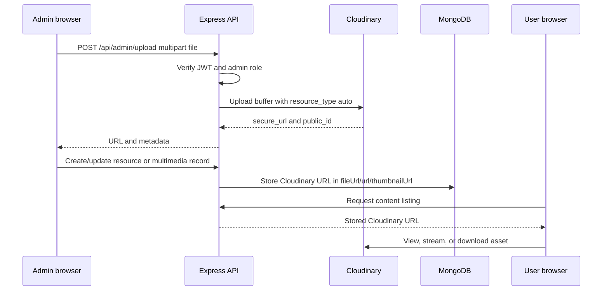
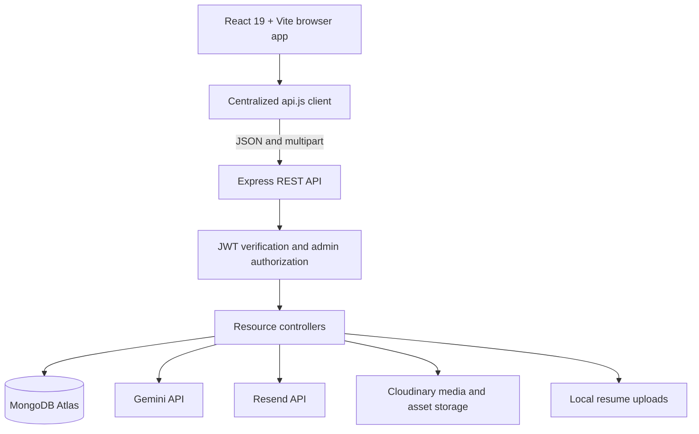
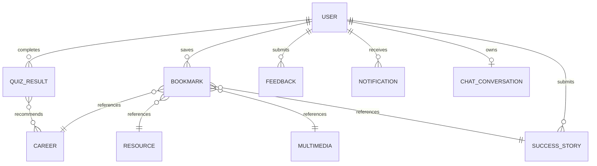

# PathSeeker Presentation Brief

> Generator-ready project dossier and presentation specification for the Career-Path repository.
>
> **Product:** PathSeeker Career Passport  
> **Theme:** Decoding Careers: From Curiosity to Career  
> **Competition context:** Aptech TechWiz 6  
> **Audience:** judges, educators, career counselors, students, families, and technical reviewers  
> **Document status:** based on the repository implementation available on 2026-08-27

---

## 1. Presentation Objective

Create a clear, credible presentation that explains why PathSeeker exists, demonstrates how it works, shows the technical architecture behind it, and makes the product's differentiator memorable.

The presentation must answer five questions:

1. What career-choice problem does PathSeeker solve?
2. Who benefits from it?
3. What can a user do from first visit to next action?
4. What makes the system technically credible and different from a basic CRUD application?
5. What is implemented today, and what remains on the roadmap?

### Primary presentation outcome

The audience should leave with this understanding:

> PathSeeker turns a confusing career decision into a guided process: understand yourself, explore realistic options, compare trade-offs, and take one practical next step.

### Core message

**PathSeeker is a Pakistan-focused Career Passport that helps students, graduates, and professionals move from uncertainty to an informed next step.**

### Differentiator

The strongest differentiator is the **Decision Helper**: two careers are compared side by side across 11 explainable dimensions, including salary, growth, study time, Pakistan readiness, international potential, work-life balance, risk, flexibility, government-scheme availability, skill overlap, and job demand.

### Supporting differentiators

- Role-aware experiences for students, graduates, and professionals.
- A quiz that combines interest, aptitude, and reality-oriented questions.
- Career profiles with Pakistani education pathways, PKR salary ranges, required skills, demand, and roadmap steps.
- An authenticated AI career copilot grounded in the user's profile, latest quiz, career data, and resources.
- Admin moderation and content operations rather than a static information website.
- Cloudinary-backed admin uploads for images, video, audio, and PDFs.

---

## 2. Problem Statement

Career decisions after Matric, F.Sc, ICS, A-Levels, university, or early employment are often made with incomplete information. Learners and families must compare:

- Subjects and educational eligibility.
- Entrance tests and degree paths.
- Cost, location, salary, and employability.
- Local opportunities versus remote or international opportunities.
- Formal degrees versus skills and portfolio-based routes.
- Advice from family, peers, social media, and disconnected websites.

Most career websites provide lists or generic quizzes. They rarely connect a user's context to an explainable comparison and a practical next action.

### Problem in one sentence

**Learners receive too many disconnected career suggestions and too little decision support.**

### Product response

PathSeeker combines discovery, assessment, comparison, learning resources, real stories, and guided follow-through in one Career Passport experience.

### Pakistan-specific context

The product is designed around:

- Matriculation and F.Sc/ICS pathways.
- Pre-Engineering, Pre-Medical, I.Com, FA, and A/O Levels.
- MDCAT, ECAT, NUST NET, FAST tests, and NTS-style decisions.
- Pakistani universities and institutions such as NUST, FAST-NUCES, LUMS, UET, COMSATS, GIKI, IBA, AKU, and Dow.
- PKR salary bands.
- Pakistani cities including Lahore, Islamabad, Karachi, Peshawar, Quetta, and other regions.
- HEC, PEEF, Ehsaas, SEEF, and related scholarship or skills pathways.

---

## 3. Objectives

### Product objectives

1. Reduce career-choice paralysis.
2. Make career information understandable for different life stages.
3. Connect interests and strengths to realistic career domains.
4. Make trade-offs visible instead of hiding them behind one recommendation.
5. Convert research into a practical roadmap.
6. Keep guidance free and accessible through a responsive web application.
7. Provide content administrators with tools to manage the platform.
8. Use AI as a grounded copilot rather than an unbounded source of invented advice.

### Technical objectives

1. Deliver a responsive React single-page application.
2. Provide REST APIs through Express.
3. Persist user, career, quiz, resource, media, story, feedback, bookmark, notification, and chat data in MongoDB.
4. Enforce authentication and admin authorization with JWT middleware.
5. Store uploaded media and documents using Cloudinary.
6. Send password-reset OTPs through Resend.
7. Keep public GET experiences resilient with session caching and static fallback data.
8. Validate important inputs and bound public query sizes.
9. Support local development, seeded demonstrations, and production configuration through environment variables.

### Success criteria

- A first-time visitor can understand the product within 30 seconds.
- A signed-in user can complete a quiz and view recommended careers.
- A user can compare two careers with the Decision Helper.
- A user can save careers/resources and add notes.
- A user can view media and download resources.
- An admin can manage content and approve stories.
- The application builds successfully.
- Backend contract tests pass.
- Secrets are provided through deployment configuration, not source code.

---

## 4. Target Users

| User | Need | PathSeeker experience |
|---|---|---|
| Student | Understand what to do after school or intermediate education | Role-aware dashboard, interest quiz, career bank, education path, scholarships/resources, beginner roadmap |
| Graduate | Validate or redirect an early career decision | Career comparison, salary and demand data, skill gap, multimedia, saved notes, practical next steps |
| Professional | Switch fields or upskill deliberately | Profile-based context, career bank, media, resources, AI copilot, roadmap and comparison |
| Admin | Keep content accurate and support users | Dashboard analytics, CRUD management, story approval, feedback responses, announcements, Cloudinary uploads |
| Family/counselor | Discuss options with evidence | Shareable career information, visible trade-offs, PKR salary ranges, education pathways, stories and resources |

---

## 5. End-to-End User Journey


### Demonstration journey

Use a student persona from Lahore or Islamabad who has completed ICS or F.Sc and is unsure between technology, engineering, healthcare, and business.

1. Open the public home page.
2. Explain the confusion in one sentence.
3. Sign in as a student.
4. Complete the Interest Quiz.
5. Show the top domain and recommended careers.
6. Open a career profile and show PKR salary, demand, skills, education path, and roadmap.
7. Open Decision Helper and compare two options.
8. Save one career with a sticky note.
9. Open a related resource or media item.
10. Ask the AI copilot for a next action.
11. Switch to the admin panel and show content operations.

---

## 6. Implemented Product Capabilities

### 6.1 Public experience

Implemented routes:

- `/` - Guest Home
- `/careers` - public career preview
- `/stories` - approved success stories
- `/resources` - public resource preview
- `/about` - product explanation

Public experience includes navigation, hero content, role-oriented entry points, career discovery, stories, resources, responsive layouts, theme support, and a sitemap modal.

### 6.2 Authentication and profiles

Implemented behavior:

- Registration and login.
- Roles: `student`, `graduate`, `professional`, `admin`.
- JWT bearer-token authentication.
- Active-user checks.
- Password hashing with bcryptjs.
- Profile editing.
- Skills, interests, education, institution, field of study, and experience.
- Resume upload through the existing local resume route.
- Password reset with secure OTP generation, hashed OTP storage, expiry, and Resend delivery.

### 6.3 User dashboard

The dashboard currently provides:

- Role-aware greeting.
- Trending and featured careers.
- Role-filtered top picks.
- Quiz history.
- Career activity widgets.
- Direct entry points to the quiz, Decision Helper, and saved notes.

Important accuracy note: some dashboard recommendations are currently role-filtered or curated rather than a full behavioral recommendation engine.

### 6.4 Career Bank

Career records contain:

- Title and domain.
- Description and overview.
- Required skills.
- Education path.
- PKR salary range.
- Job demand.
- Target audience.
- Roadmap steps.
- Featured/trending flags.
- View count.

Current discovery capabilities include domain, demand, minimum salary, search, required-skill matching, audience, featured, trending, autocomplete suggestions, saved filters, bookmarks, and paginated backend responses.

### 6.5 Interest Quiz

The quiz supports these model types:

- `single_choice`
- `slider`
- `likert_scale`
- `multi_select`

Implemented behavior includes:

- Timed questions.
- Answer-required validation.
- Invalid question and option validation on the backend.
- Domain-weight scoring.
- Top-domain selection.
- Recommended careers.
- Persisted quiz result history.
- Admin question CRUD.

### 6.6 Decision Helper

The Decision Helper is the primary product differentiator.

It compares two career records across 11 axes:

1. Salary band.
2. Five-year growth.
3. Total study time.
4. Go-abroad potential.
5. Pakistan-ready score.
6. Work-life balance.
7. Risk level.
8. Location flexibility.
9. Government-scheme availability.
10. Skill overlap.
11. Job demand.

The scoring is intentionally explainable and heuristic. It presents trade-offs rather than claiming that one career is universally correct.

### 6.7 Multimedia Center

Implemented capabilities:

- Video, podcast, and animated-explainer records.
- Embedded URLs or uploaded media URLs.
- Cloudinary-hosted media support through the admin uploader.
- Thumbnail images.
- Transcript text.
- Duration.
- Tags and audience filters.
- View tracking.
- Rating submission with one stored rating per user.
- Admin CRUD.

### 6.8 Resource Library

Implemented capabilities:

- PDF, checklist, infographic, guide, template, and worksheet records.
- Search and filtering.
- Preview text.
- Download tracking.
- Admin CRUD.
- Cloudinary-hosted PDF and image support through the admin uploader.
- Public viewing/downloading through the stored `fileUrl`.

### 6.9 Success Stories

Implemented capabilities:

- Approved public stories.
- Domain and user-type filtering.
- User story submission endpoint.
- Admin approval and featured controls.
- Admin deletion.

The authenticated submission interface and richer story editing remain future work.

### 6.10 Bookmarks and notes

Implemented capabilities:

- Career, resource, multimedia, and story bookmark types.
- User-owned bookmark queries.
- Sticky notes.
- Note editing.
- Bookmark deletion.
- Compound uniqueness index on user, item type, and item ID.
- Print-based notes export path.

### 6.11 Feedback and notifications

Implemented capabilities:

- Authenticated feedback submission.
- User feedback history.
- Keyword-based sentiment categories.
- Admin feedback inbox.
- Admin response workflow.
- In-app notifications for responses.
- Admin broadcasts.
- Mark-all-read behavior.

### 6.12 AI Career Copilot

Implemented behavior:

- Authenticated chat route: `POST /api/ai/chat`.
- Persistent history route: `GET /api/ai/history`.
- Profile context.
- Latest quiz context.
- Matching career context.
- Matching resource context.
- Gemini API integration when configured.
- Grounded fallback response when Gemini is unavailable.
- Bounded conversation history and message length.
- React chat panel with rendered AI responses.

Important accuracy note: the current implementation sends controlled context directly in the prompt. The separately documented Gemini function/tool-calling architecture is proposed, not fully implemented.

### 6.13 Cloudinary asset management

Implemented backend flow:



Supported admin upload categories:

- Images.
- Video.
- Audio.
- PDFs.

The upload route is admin-only and uses memory storage before forwarding the file to Cloudinary. The existing resume route remains separate and local.

### 6.14 Resend OTP email

Implemented behavior:

- Secure six-digit OTP generation.
- OTP expiration after 15 minutes.
- Bcrypt-hashed OTP persistence.
- Resend API delivery.
- Branded HTML and plain-text email versions.
- Generic response for unknown email addresses.
- Local development fallback code only when Resend is not configured.

---

## 7. Technical Architecture

### High-level architecture



### Frontend architecture

- React 19.
- Vite build and development server.
- `react-router-dom` route management.
- `AuthContext` for user, auth modal, theme, font-size, notification, and sitemap state.
- Centralized API functions in `Frontend/src/services/api.js`.
- `apiFetch` for JSON APIs.
- `apiFetchRaw` for multipart uploads.
- `uploadAdminAsset` for Cloudinary upload route integration.
- Shared shells: `UserShell` and `AdminShell`.
- Shared components: Navbar, Footer, loaders, headers, sections, reveal animations, notifications, sitemap, chatbot, and AI message renderer.
- Recharts for admin visualizations.
- Lucide React for icons.
- Canvas Confetti for quiz completion.
- CSS variables and responsive CSS in `index.css`, with additional premium styles.

### Backend architecture

- Node.js CommonJS server.
- Express 5.
- Mongoose 9.
- JWT authentication.
- bcryptjs password hashing.
- Multer for multipart parsing and file constraints.
- Helmet for security headers.
- CORS with configurable origin.
- Express rate limiting on authentication endpoints.
- Cloudinary SDK for managed admin assets.
- Resend HTTP API for password-reset delivery.

### Backend request lifecycle

1. Browser sends a request through the centralized API client.
2. JWT is attached when a session exists.
3. CORS and JSON/multipart parsing run.
4. Protected routes verify the token and load the active user.
5. Admin routes check `req.user.role === 'admin'`.
6. Controller validates, queries, mutates, or delegates to an external service.
7. Controller returns a JSON response.
8. The frontend updates state or displays an error.

---

## 8. Data Model Inventory

| Model | Main responsibility | Important fields |
|---|---|---|
| User | Accounts and profiles | name, email, password, role, education, skills, interests, active state, reset OTP |
| Career | Career knowledge base | title, domain, description, requiredSkills, educationPath, salaryRange, demand, roadmap, views |
| QuizQuestion | Assessment question bank | questionText, type, category, timeLimitSeconds, options, domainWeights |
| QuizResult | User assessment history | userId, domainScores, topDomain, recommendedCareers, answers |
| Bookmark | User-saved content | userId, itemType, itemId, title, subtitle, stickyNote, category |
| Feedback | Support and product feedback | user, category, subject, message, sentiment, status, adminResponse |
| Resource | Documents and learning assets | title, type, description, fileUrl, previewContent, tags, downloads |
| SuccessStory | User and curated stories | name, role, domain, avatar, summary, timeline, approval, featured |
| Multimedia | Video, audio, and explainers | title, type, url, thumbnailUrl, transcript, tags, ratings, likes, views |
| Notification | In-app user notices | userId, title, message, type, isRead, createdAt |
| ChatConversation | Private AI history | userId, embedded messages, timestamps |

### Relationships



---

## 9. API Inventory

### Authentication and profile

| Method | Endpoint | Access | Purpose |
|---|---|---|---|
| POST | `/api/sign-up` | Public | Register account |
| POST | `/api/sign-in` | Public | Authenticate and return JWT |
| POST | `/api/forgot-password` | Public | Generate and email OTP |
| POST | `/api/reset-password` | Public | Verify OTP and change password |
| GET | `/api/profile` | User | Fetch own profile |
| PUT | `/api/profile` | User | Update own profile |
| POST | `/api/upload-resume` | User | Upload existing resume format |

### Cloudinary uploads

| Method | Endpoint | Access | Purpose |
|---|---|---|---|
| POST | `/api/admin/upload` | Admin | Upload image, video, audio, or PDF to Cloudinary |

Request format: multipart form data with field `file` and optional `folder`.

Response includes:

```json
{
  "message": "File uploaded successfully",
  "url": "https://res.cloudinary.com/...",
  "publicId": "pathseeker/resources/example",
  "resourceType": "image",
  "format": "png",
  "bytes": 123456
}
```

### Career and quiz

| Method | Endpoint | Access | Purpose |
|---|---|---|---|
| GET | `/api/careers` | Public | Search and paginate careers |
| GET | `/api/careers/suggestions` | Public | Typeahead suggestions |
| GET | `/api/careers/:id` | Public | Career details and view increment |
| POST/PUT/DELETE | `/api/careers/:id` | Admin | Career CRUD |
| GET | `/api/quiz/questions` | Public | Question bank |
| POST | `/api/quiz/submit` | User | Validate, score, persist quiz |
| GET | `/api/quiz/history` | User | User quiz history |
| POST/PUT/DELETE | `/api/quiz/questions/:id` | Admin | Question CRUD |

### Media, stories, and resources

| Method | Endpoint | Access | Purpose |
|---|---|---|---|
| GET | `/api/multimedia` | Public | Filtered media list |
| GET | `/api/multimedia/:id` | Public | Media detail and view increment |
| POST | `/api/multimedia/:id/rate` | User | Create or update rating |
| POST/PUT/DELETE | `/api/multimedia` | Admin | Media CRUD |
| GET | `/api/stories` | Public | Approved stories |
| POST | `/api/stories` | User | Submit story |
| PUT/DELETE | `/api/admin/stories/:id` | Admin | Moderate stories |
| GET | `/api/resources` | Public | Filtered resources |
| POST | `/api/resources/:id/download` | Public | Track download |
| POST/PUT/DELETE | `/api/resources` | Admin | Resource CRUD |

### User support and administration

| Method | Endpoint | Access | Purpose |
|---|---|---|---|
| POST | `/api/feedback` | User | Submit feedback |
| GET | `/api/feedback/my` | User | Own feedback |
| PUT | `/api/admin/feedback/:id/respond` | Admin | Respond and notify |
| GET/POST/PUT/DELETE | `/api/bookmarks` | User | Saved items and notes |
| GET/PUT | `/api/notifications` | User | Notifications and read state |
| GET | `/api/admin/dashboard-stats` | Admin | Counts and dashboard data |
| GET/PUT | `/api/admin/users` | Admin | User list and role/status updates |
| POST | `/api/admin/broadcast` | Admin | Broadcast announcement |
| POST | `/api/ai/chat` | User | Grounded AI response |
| GET | `/api/ai/history` | User | Persistent chat history |

---

## 10. Security and Reliability

### Implemented protections

- JWT bearer-token verification.
- Active-account check on protected requests.
- Role-based admin middleware.
- bcryptjs password hashing.
- Hashed password-reset OTP storage.
- OTP expiry.
- Generic forgot-password response for unknown accounts.
- Authentication endpoint rate limiting.
- Configurable CORS.
- Helmet security headers.
- Disabled Express `x-powered-by` header.
- Upload size limits.
- Upload MIME allowlists.
- Admin-only Cloudinary upload route.
- Bounded career and multimedia list queries.
- Static public GET fallbacks.
- Session storage API caching.
- Mutation failures are not silently converted into success.

### Required deployment precautions

- Do not commit `.env` files.
- Rotate any credentials exposed during development or conversation.
- Set a strong production `JWT_SECRET`.
- Set an exact production `CORS_ORIGIN`.
- Configure Cloudinary credentials only in the server environment.
- Configure a verified Resend sender for production email.
- Use HTTPS in deployed environments.
- Add centralized error handling and structured request validation before public scale.
- Validate actual file signatures in addition to MIME types for high-risk deployments.

### Environment variables

```env
DB_URL=
PORT=2408
JWT_SECRET=
CORS_ORIGIN=http://localhost:5173
GEMINI_API_KEY=
GEMINI_MODEL=gemini-2.0-flash
RESEND_API_KEY=
RESEND_FROM_EMAIL=PathSeeker <no-reply@verified-domain.example>
CLOUDINARY_CLOUD_NAME=
CLOUDINARY_API_KEY=
CLOUDINARY_API_SECRET=
```

---

## 11. Performance and Availability

### Implemented

- Frontend request timeouts.
- Session GET cache with five-minute TTL.
- Static fallback datasets for public GET endpoints.
- Pagination and bounded limits on career and multimedia listings.
- Limited AI context queries.
- MongoDB count queries for paginated resources.
- Responsive layout rules for narrow screens.
- Production frontend build succeeds.

### Known constraints

- Static fallback is not a complete offline/PWA implementation.
- Admin analytics still include in-memory aggregation patterns.
- Some public resource and story lists remain unpaginated.
- Frontend bundle has a known chunk-size warning.
- BrowserRouter deployment requires server fallback configuration for direct deep links.
- Resume files still use local server storage rather than Cloudinary.

---

## 12. Verification Status

Verified in the current repository:

- Frontend production build passes.
- Backend contract tests pass.
- Cloudinary service and upload controller pass syntax checks.
- Touched frontend and backend files have no reported diagnostics.
- Cloudinary package is installed in the server package.
- Resend email template generation produces both HTML and text output.
- The server can connect to MongoDB Atlas when valid environment configuration is available.

### Backend test coverage currently present

The built-in Node test suite verifies:

1. Bookmark compound uniqueness index.
2. Multimedia rating schema bounds.
3. Quiz question interaction-type enum support.

### Important test gaps

- Full HTTP integration tests.
- Cloudinary upload integration with a test account.
- Resend delivery integration test.
- Database transaction and concurrency tests.
- Automated accessibility tests.
- Cross-browser test matrix.
- Lighthouse baseline.
- End-to-end admin upload and user download test.

---

## 13. Honest Implementation Status

| Area | Status | Presentation wording |
|---|---|---|
| Public site and responsive UI | Implemented | "Responsive Pakistan-focused career discovery experience" |
| Authentication and roles | Implemented foundation | "JWT-protected role-based access" |
| Career Bank | Implemented foundation | "Searchable career knowledge base with PKR and roadmap data" |
| Interest Quiz | Implemented | "Timed, scored, validated multi-type assessment" |
| Decision Helper | Implemented | "Explainable 11-axis career comparison" |
| Multimedia | Implemented foundation | "Media center with transcripts, views, ratings, and admin content management" |
| Resources | Implemented foundation | "Searchable resource library with download tracking" |
| Cloudinary assets | Implemented | "Admin uploads managed through Cloudinary" |
| Resend OTP email | Implemented | "Transactional password-reset email through Resend" |
| Success Stories | Partial | "Approved stories with submission endpoint and admin moderation" |
| AI copilot | Implemented foundation | "Authenticated AI assistant grounded in platform data" |
| Personalized recommendation engine | Partial | "Role- and quiz-aware recommendations; behavioral intelligence is future work" |
| 90-day personalized plan | Partial | "Roadmap data exists; fully personalized plan generation remains future work" |
| PDF export | Partial | "Print-based export path exists; generated PDF is future work" |
| Offline/PWA | Missing | "Graceful public fallback, not full offline support" |
| Admin analytics | Partial | "Operational dashboard with counts and charts" |
| API contract documentation | Partial | "Centralized REST API documented at a high level" |

---

## 14. Recommended Presentation Structure

Target length: **8 to 10 minutes** for a technical/product presentation, or compress to the 6-slide version for a 5-minute contest pitch.

### Slide 1 - Title: From Curiosity to Career

**Headline:** PathSeeker Career Passport  
**Subtitle:** Decode your strengths. Compare your options. Take your next step.  
**Visual:** Product logo treatment, subtle career-path line, Pakistan context, no dense text.  
**Speaker point:** Career uncertainty is not a lack of ambition; it is a lack of structured decision support.

### Slide 2 - The problem

**Headline:** Career advice is everywhere. Decision clarity is not.  
**Show:** A learner facing multiple paths: university, entrance test, skills route, local job, remote work.  
**Speaker points:** Information is fragmented, family decisions involve financial and location trade-offs, and generic quizzes stop before action.

### Slide 3 - The product promise

**Headline:** One Career Passport for three life stages.  
**Show:** Student, Graduate, Professional lanes.  
**Speaker points:** Each role sees a different starting point, but all users move through the same clarity loop: assess, explore, compare, act.

### Slide 4 - How the experience works

**Headline:** From uncertainty to one practical next step.  
**Show:** User journey diagram from quiz to career profile to comparison to roadmap.  
**Speaker points:** The platform connects assessment, career data, resources, media, stories, notes, and AI guidance.

### Slide 5 - The Interest Quiz

**Headline:** Assessment that respects more than one kind of answer.  
**Show:** Timed quiz interaction and domain-score result.  
**Speaker points:** Question models include choice, slider, Likert, and multi-select; the backend validates every answer before saving a result.

### Slide 6 - The Decision Helper

**Headline:** The feature that turns suggestions into a decision.  
**Show:** Side-by-side comparison with 11 axes.  
**Speaker points:** Salary is not enough. Students can compare growth, study time, risk, flexibility, Pakistan readiness, international potential, and skill overlap.

### Slide 7 - The Career Passport record

**Headline:** Every career path has context, not just a title.  
**Show:** Career card/detail screen with PKR salary, skills, demand, education path, and roadmap.  
**Speaker points:** Local education pathways and PKR ranges make the decision discussable with families and mentors.

### Slide 8 - AI copilot and content ecosystem

**Headline:** Guidance continues after the quiz.  
**Show:** AI chat, multimedia, resources, stories, bookmarks.  
**Speaker points:** The copilot receives controlled profile, quiz, career, and resource context; media and documents provide practical follow-through.

### Slide 9 - Admin and content operations

**Headline:** A useful platform needs an operating system behind it.  
**Show:** Admin dashboard, content CRUD, approval queue, feedback inbox, Cloudinary upload flow.  
**Speaker points:** Admins manage careers, quiz questions, media, resources, stories, users, feedback, announcements, and uploaded assets.

### Slide 10 - Technical architecture

**Headline:** A modular full-stack foundation built for extension.  
**Show:** React/Vite -> Express -> controllers -> MongoDB, with Gemini, Resend, and Cloudinary integrations.  
**Speaker points:** Authentication, storage, AI, and content management are separated behind service boundaries.

### Slide 11 - Security and reliability

**Headline:** The platform treats trust as a feature.  
**Show:** JWT, role authorization, hashed passwords/OTPs, rate limiting, Helmet, CORS, upload limits.  
**Speaker points:** Public GET fallback and cache improve resilience, while production deployment still requires secret management, HTTPS, and verified external service configuration.

### Slide 12 - Implementation evidence

**Headline:** Working foundation, verified with builds and tests.  
**Show:** Build/test status and selected test categories.  
**Use:** "Frontend build passes. Backend contract tests pass. Upload and email services load successfully."  
**Do not claim:** Complete SRS compliance, full offline support, or a mature behavioral recommendation model.

### Slide 13 - Roadmap

**Headline:** From strong MVP to production platform.  
**Priorities:**

1. Complete Cloudinary deployment configuration and production asset lifecycle.
2. Add HTTP integration and end-to-end tests.
3. Add personalized 90-day plan generation.
4. Add behavior-backed recommendations.
5. Add real PDF/share/export workflows.
6. Add story submission and editing UI.
7. Add PWA/offline queue if offline use is a true requirement.
8. Add aggregation-based analytics and OpenAPI documentation.

### Slide 14 - Closing

**Headline:** PathSeeker: a clearer next step for every learner.  
**Closing line:** From curiosity to career, decoded.  
**Call to action:** Explore a career, compare two paths, and take one action today.

---

## 15. Five-Minute Compressed Pitch

### 0:00-0:30 - Hook

"A learner finishes ICS or F.Sc and is asked to choose a future from a dozen paths. The problem is not a lack of information. The problem is knowing what to do next."

### 0:30-1:10 - Problem

"Career advice is fragmented, counseling is not equally available, and decisions involve subjects, cost, location, employability, and family expectations. Generic quizzes produce labels, not decisions."

### 1:10-2:50 - Demo

- Open PathSeeker as a student.
- Complete the Interest Quiz.
- Show the top domain and career matches.
- Open a career profile with PKR salary, skills, demand, education path, and roadmap.
- Compare two careers in Decision Helper.
- Save a career and open a resource or media item.
- Ask the AI copilot for a practical next action.

### 2:50-3:45 - Technical credibility

"The frontend is React and Vite. The backend is Express and Mongoose over MongoDB Atlas. JWT protects user and admin workflows. Gemini is used through a controlled backend context. Resend handles password-reset OTPs. Cloudinary stores admin images, media, and PDFs."

### 3:45-4:30 - Admin and impact

"The platform is not only a consumer screen. Admins manage careers, quiz questions, stories, resources, media, feedback, users, announcements, and uploaded content. The result is a maintainable career guidance system rather than a static quiz."

### 4:30-5:00 - Close

"PathSeeker gives learners a way to understand themselves, see realistic options, compare trade-offs, and take one next step. PathSeeker: from curiosity to career, decoded."

---

## 16. Visual and Design Direction for the Presentation

### Brand direction

- Primary: indigo `#6366F1`.
- Secondary: violet `#8B5CF6`.
- Accent: pink `#EC4899`.
- Support colors: cyan, emerald, amber, rose.
- Light surfaces: white and slate-50.
- Dark surfaces: navy/slate.
- Typography: Outfit for display, Plus Jakarta Sans for body.
- Visual language: modern educational SaaS, glass panels, subtle gradients, clear comparison bars, restrained motion.

### Layout rules

- One message per slide.
- Use product screenshots or UI mockups as primary evidence.
- Use diagrams for data flow and architecture.
- Keep body text short; move detail into speaker notes.
- Use large numerals for the 11-axis comparison and role count.
- Use PKR and Pakistan-specific examples in screenshots.
- Do not use unsupported claims as visual headlines.

### Suggested visual assets

1. PathSeeker logo/mark.
2. Home page screenshot.
3. Quiz result screenshot.
4. Decision Helper screenshot.
5. Career detail screenshot.
6. AI copilot screenshot.
7. Admin dashboard screenshot.
8. Cloudinary upload flow diagram.
9. Architecture diagram.
10. Roadmap/next-steps visual.

### Do not use

- Generic stock photos as the main proof of product value.
- Unsupported statistics presented as measured results.
- "Fully offline" language.
- "Predictive AI" or "collaborative filtering" language for current recommendations.
- "Fully SRS compliant" language.
- A dense wall of API endpoints on a visual slide.

---

## 17. Demo Readiness Checklist

### Before presenting

- [ ] Configure `DB_URL`.
- [ ] Configure `JWT_SECRET`.
- [ ] Configure exact `CORS_ORIGIN`.
- [ ] Configure Gemini only if demonstrating live Gemini responses.
- [ ] Configure Resend sender according to account/domain restrictions.
- [ ] Configure Cloudinary credentials.
- [ ] Run the demo seeder if a populated database is required.
- [ ] Start the server on port 2408.
- [ ] Start the frontend on port 5173.
- [ ] Confirm the admin account works.
- [ ] Confirm at least one resource, one media item, and one career have valid URLs.
- [ ] Upload one test image, one media file, and one PDF from the admin panel.
- [ ] Open each uploaded asset as a user.
- [ ] Request a password reset using an allowed Resend recipient.
- [ ] Verify the HTML email is rendered, not just the text fallback.
- [ ] Verify the Decision Helper with two distinct careers.
- [ ] Check the presentation screenshots at desktop and mobile widths.

### Demo accounts used by the seeders

These are development/demo credentials only and must not be used in production:

- Admin: `admin@pathseeker.com` / `password123`
- Student: `alex@student.com` / `password123`
- Graduate: `sarah@graduate.com` / `password123`
- Professional: `david@pro.com` / `password123`

---

## 18. Post-Presentation Engineering Roadmap

### Priority 0: deployment safety

- Rotate exposed credentials.
- Store secrets in deployment configuration.
- Verify Cloudinary and Resend sender setup.
- Use HTTPS.
- Add centralized error handling.
- Add stricter schema validation for all write endpoints.
- Add account lockout or per-email reset throttling.

### Priority 1: product completion

- Build a real personalized 90-day plan with weekly tasks and linked resources.
- Add user-facing story submission and edit workflows.
- Add media likes and multimedia bookmarks if required by the SRS.
- Add shareable comparison URLs and real PDF generation.
- Add behavior-backed recommendations from views, bookmarks, ratings, and quiz similarity.
- Add province and government-scheme filters.

### Priority 2: operational maturity

- Add HTTP integration tests.
- Add accessibility automation.
- Add browser matrix testing.
- Add Lighthouse baseline.
- Add OpenAPI documentation.
- Add aggregation-based admin time-series analytics.
- Add Cloudinary deletion/cleanup when content is deleted or replaced.
- Migrate resumes to Cloudinary if centralized asset storage is required.
- Add PWA manifest, service worker, IndexedDB cache, and mutation queue only if offline support remains a product requirement.

---

## 19. Generator Prompt

Use this prompt with an HTML, PowerPoint, or slide-generation system:

> Create a polished 14-slide presentation for PathSeeker Career Passport, a Pakistan-focused career guidance platform built for the Aptech TechWiz 6 theme "Decoding Careers: From Curiosity to Career." The narrative should move from career-choice confusion to a guided decision workflow. Explain the problem, objectives, target users, product journey, Interest Quiz, 11-axis Decision Helper, Career Bank, AI career copilot, resources, multimedia, success stories, admin panel, Cloudinary uploads, Resend OTP email, architecture, security, testing, roadmap, and closing impact. Use an intentional modern educational SaaS style with indigo #6366F1, violet #8B5CF6, pink #EC4899, white/slate surfaces, Outfit headings, Plus Jakarta Sans body text, subtle grid or path motifs, and clean comparison bars. Use diagrams and UI evidence instead of generic stock imagery. Keep each slide focused on one message. State limitations honestly: the current system has graceful public GET fallbacks rather than a full PWA, recommendations are role/quiz-aware rather than a mature behavioral engine, PDF export is print-based, and AI context is prompt-grounded rather than full tool-calling. End with the line: "PathSeeker: from curiosity to career, decoded." Include concise speaker notes for every slide and a final appendix slide with the REST architecture and data model.

---

## 20. Source Files Used for This Brief

Primary implementation sources:

- `Frontend/src/App.jsx`
- `Frontend/src/services/api.js`
- `Frontend/src/pages/user/UserDashboard.jsx`
- `Frontend/src/pages/user/CareerBank.jsx`
- `Frontend/src/pages/user/InterestQuiz.jsx`
- `Frontend/src/pages/user/DecisionHelper.jsx`
- `Frontend/src/pages/user/MultimediaCenter.jsx`
- `Frontend/src/pages/user/BookmarksAndNotes.jsx`
- `Frontend/src/pages/user/UserProfile.jsx`
- `Frontend/src/pages/admin/AdminDashboard.jsx`
- `Frontend/src/pages/admin/ManageMultimedia.jsx`
- `Frontend/src/pages/admin/ManageResources.jsx`
- `Server/Router.js`
- `Server/server.js`
- `Server/middleware/authMiddleware.js`
- `Server/controller/aiController.js`
- `Server/controller/careerController.js`
- `Server/controller/quizController.js`
- `Server/controller/multimediaController.js`
- `Server/controller/resourceController.js`
- `Server/controller/storyController.js`
- `Server/controller/uploadController.js`
- `Server/services/cloudinaryService.js`
- `Server/services/emailService.js`
- `Server/models/*.js`
- `Server/demoSeeder.js`
- `Server/package.json`

Supporting documentation:

- `README.md`
- `CONTEST_PLAN.md`
- `PLAN.md`
- `report.md`
- `chatbot-implementation.md`
- `design-system/pathseeker/MASTER.md`

---

## Final Presentation Positioning

PathSeeker should be presented as:

> **A decision-support platform for Pakistani learners, not merely a career quiz and not merely a content library.**

The product's strongest story is the connected loop:

**Profile -> Quiz -> Career Bank -> Decision Helper -> Resources/Media -> AI guidance -> Next action.**

That loop is the center of the presentation. Everything else supports it.
